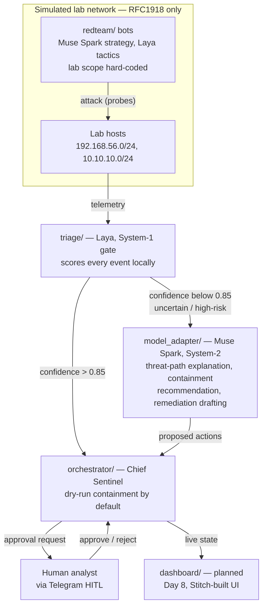
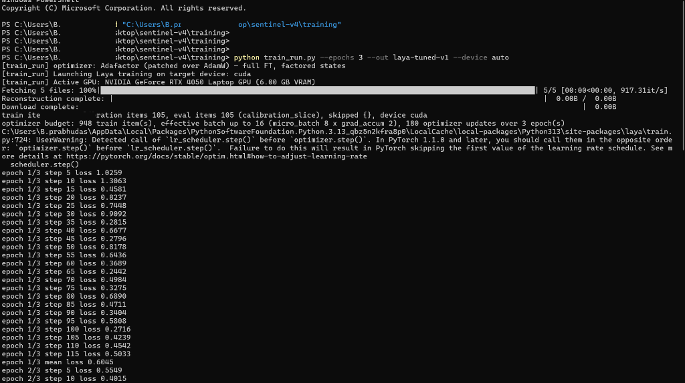
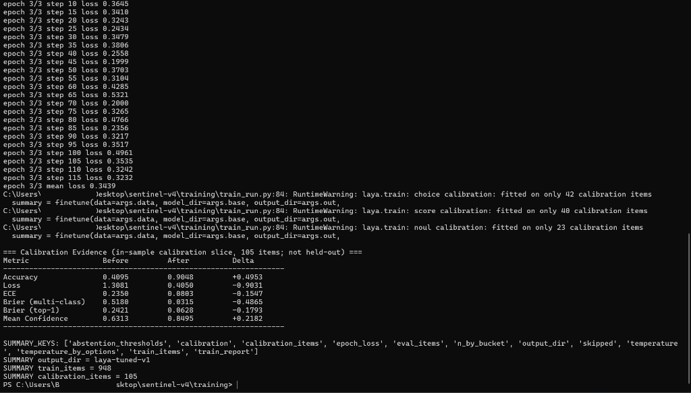

# Sentinel V4 — AI SOC Copilot (Meta Global AI Developer Hackathon)

> **What was pre-existing vs what was built this week:** Sentinel V3 (the college SOC project — NetworkX threat graphing, GraphSAGE lateral-movement prediction, MCP reasoning, Telegram HITL SOAR) is the pre-existing baseline and lives in a separate repository. **Everything in this repo was built during the hackathon (Oct 26 – Nov 4, 2026):** the dual-system AI SOC copilot below — Laya System-1 triage gate + Muse Spark System-2 reasoning, LLM red-team bots, the orchestrator, and the replay harness.

Purple-team demo: LLM red-team bots attack a **simulated lab network** while an AI SOC copilot (Laya triage + Muse Spark reasoning) defends it, live on a dashboard, with a human approving every action.

## 🏗️ Architecture



How an event flows:

1. Red-team bots attack the simulated lab (RFC1918 addresses only; scope is hard-coded).
2. Lab telemetry reaches the Laya gate, which scores every event.
3. Confidence above 0.85 → **fast path**: the orchestrator proposes dry-run reversible containment.
4. Confidence below 0.85 → **slow path**: Muse Spark reasons about the threat path and recommends containment.
5. Every proposed action goes to the human analyst via Telegram HITL for approval or rejection.
6. The dashboard shows live state (planned — Day 8).

Muse Spark is reached ONLY through `model_adapter/` — prompts stay model-agnostic, and the MCP tool interface from Sentinel V3 stays unchanged.

## 🗂️ Project structure

```
triage/          Laya System-1 gate
model_adapter/   Muse Spark System-2 client
orchestrator/    Chief Sentinel — dry-run containment + Telegram HITL
redteam/         LLM red-team bots (simulated lab only)
scripts/         replay harness (Gate 1)
tests/           29 tests
docs/            Laya training proof screenshots (assets/)
dashboard_notes/ dashboard notes
requirements.txt pinned dependencies
```

## ✅ What is built and verified

- **`model_adapter/client.py`** — `MuseSparkClient` implementing the `ReasoningClient` protocol. Model pinned to `muse-spark-1.3` (any other model raises `ValueError`); `tool_choice` only `"auto"`; tool names validated; API URLs allow-listed (scheme + host).
- **Security fixes §1.1–§1.7** (verified from code, not from claims):
  - §1.1 prompt-injection tag breakout quarantined (`quarantine_untrusted_text`, `</` escaped).
  - §1.2 containment via typed `ContainmentProposal` bound to an explicit `approval_id` — model prose is non-executable by design.
  - §1.3 model pin + API URL validation.
  - §1.4 lab scope accepts literal lab IPs only (hostnames denied — no DNS rebinding).
  - §1.5 pinned `requirements.txt`.
  - §1.6 non-finite confidence (`inf`/`NaN`) forces escalation (`math.isfinite`).
  - §1.7 SSE multi-line event folding, tool-schema validation, bounded retries with backoff, `raw_decode` JSON parsing.
- **`scripts/replay_scenarios.py`** — Gate 1 replay harness, 3/3 scenarios PASS (verified):
  - Scenario 1 (SSH brute force + lateral movement): PASS, conf 0.87 — dry-run reversible containment with TTL + approval request + threat-path evidence.
  - Scenario 2 (C2 beaconing + exfiltration): PASS, conf 0.82 — targeted isolation with TTL, zero blanket actions.
  - Scenario 3 (benign discriminator): PASS, conf 0.91 — zero containment proposals, zero approval requests, explicit benign classification.
- **Tests: 29/29 pass** (`python -m pytest tests/`), including the three hardening tests that were missing before: tag breakout, multi-line SSE folding, inf/NaN confidence escalation.

## 🤖 Laya (System-1 gate)

Laya is the fine-tuned triage model behind the gate. Training proof screenshots (RTX 4050, redacted):





Held-out evaluation ([EVAL.md](EVAL.md), tested on 101 held-out rows with zero training template overlap):
- **Verdict Accuracy:** 88.12% (+18.81% absolute gain over foundation baseline 69.31%)
- **Autonomous Auto-Act Rate ($\ge 0.85$):** 83.17% (2.6x increase over baseline 31.68% at 91.67% accuracy)
- **Cognitive Alert Fatigue Reduction:** Reduces Muse Spark escalations from 68.32% down to **16.83%**
- **Severity Prediction MAE:** 0.1262 (47.1% error reduction over baseline 0.2388)
- **Execution Latency:** 54 ms mean / 51 ms median (steady-state sub-55ms fast triage)

See full metrics and confusion breakdown in [EVAL.md](EVAL.md).

## 🧪 Run it

```bash
python -m pytest tests/          # 29 passed
python scripts/replay_scenarios.py   # 3/3 scenarios passed
```

## 📋 Submission

- **Portal:** https://cerebralvalley.ai/e/meta-ai-developer-hackathon/hackathon/submit
- **Deadline:** November 4, 2026, 9:00 PM ET (November 5, 7:30 AM IST).
- **Demo video (3 minutes, required):** opens with the pre-existing-vs-built-this-week line above.
- **Track:** Build for Your World. **Tooling:** Muse Spark series via the Meta Model API; open-weight bonus path via Muse Glimmer / Muse Spark Open on local hardware.

## ⚠️ Rules note

New work only: this repo was created Oct 26, 2026 and contains only hackathon-week work. Pre-existing work (Sentinel V3) is named here and in the video, lives in its own repository, and is not judged. The demo runs standalone with mock/demo data available for judges.

## License

This project is licensed under the MIT License — see the [LICENSE](LICENSE) file.

Copyright (c) 2026 hearthacker003366
